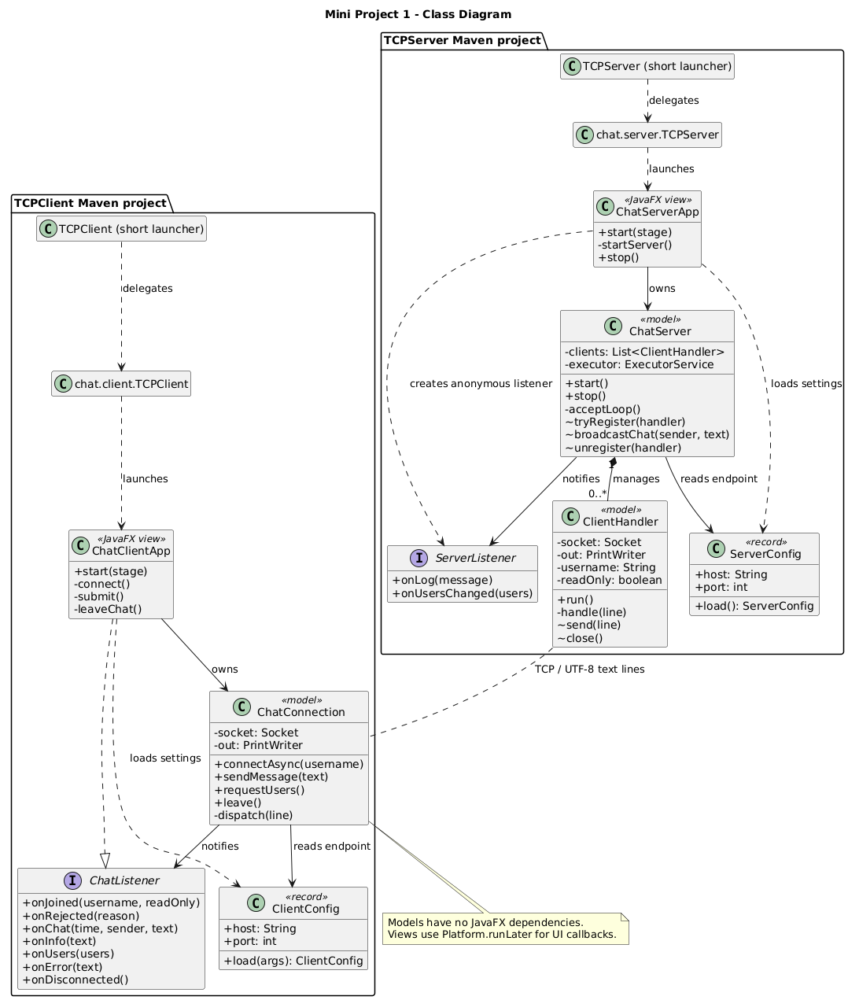
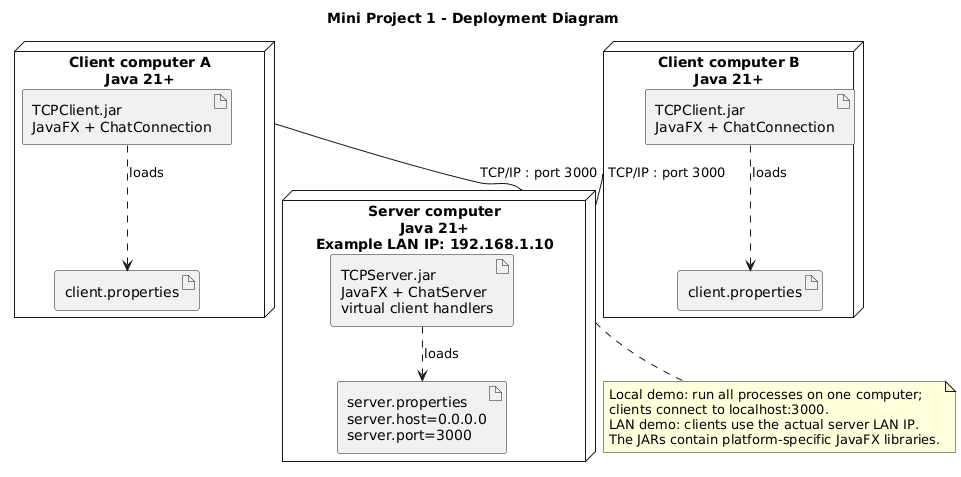
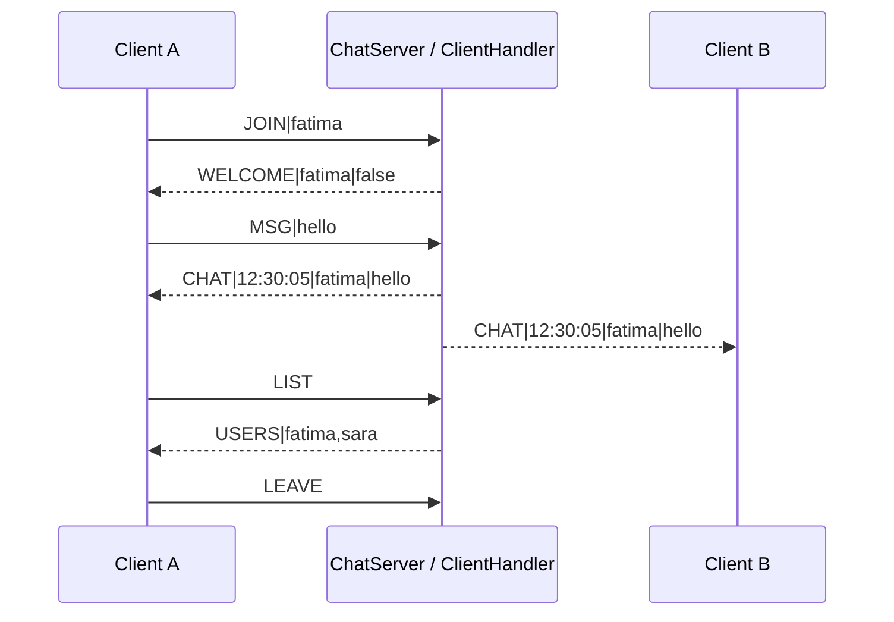

# Mini Project 1 – Multi-Client Chat (Java Sockets TCP + JavaFX)

Author: Fatima Zahrae – Course supervisor: El Habib Nfaoui

Two Maven projects: `TCPServer` and `TCPClient` (Java 21, JavaFX 21).

## Build
```
mvn clean package  # from the project root: builds both modules

# Or build independently from the project root:
mvn -f TCPServer/pom.xml clean package
mvn -f TCPClient/pom.xml clean package
```
## Run
Extract the ZIP. Open separate terminals in `dist`: start the server first, then one client per terminal. Java 21 or newer is required.

```
java -jar TCPServer.jar
java -jar TCPClient.jar localhost 3000       # <ServerIPAddress> <PortNumber>
```
(or `mvn javafx:run`, or IntelliJ with program arguments `localhost 3000`.)
Defaults come from `server.properties` / `client.properties`. An external file in the current working directory overrides the bundled one; command-line arguments override the client file.
The supplied JARs in `dist` target Windows x64 and include JavaFX native libraries. Rebuild on other operating systems or CPU architectures. After changing code, copy the new module target JARs into dist.

You can also double-click `dist/start-server.bat` and `dist/start-client.bat`; these set the working directory correctly.

## Client commands
`allUsers` (list active users) · `end` / `bye` / LEAVE button (disconnect) · empty username = READ-ONLY MODE.

## Architecture
Both projects separate `model` (sockets, threads, protocol – no JavaFX import) from `view` (JavaFX).
The model talks to the view only through a listener interface (`ServerListener`, `ChatListener`).

### Class diagram


### Deployment diagram


SVG and editable PUML versions are also included. ChatServerApp creates an anonymous ServerListener; ChatClientApp directly implements ChatListener.

### Sequence diagram (sending a message)


## Protocol
| Direction | Line |
|---|---|
| client → server | `JOIN|name` (empty = read-only), `MSG|text`, `LIST`, `LEAVE` |
| server → client | `WELCOME|name|readOnly`, `REJECTED|reason`, `CHAT|time|user|text`, `INFO|text`, `USERS|a,b,c`, `ERROR|text` |

## Configuration and commands

The server reads server.properties; the client reads client.properties. Edit the external files in dist and restart to change the endpoint without recompiling. Client arguments override its properties. For a local demo use localhost:3000. For a LAN demo, clients use the real server LAN IP; 0.0.0.0 is a server bind address, not a client destination. Both host and port are validated.

In read-only mode, ordinary chat is blocked. The input and RUN button still allow allUsers, bye and end. Server-side checks prevent a modified client from bypassing read-only mode. Usernames are sanitized and limited to 20 characters; duplicate named users are rejected case-insensitively. Each normal message is echoed once to its sender and all other active clients.

## Literal main-class launch

The default-package launchers match the names requested in the assignment. From dist, with each command in a separate terminal:

```bat
java -cp TCPServer.jar TCPServer
java -cp TCPClient.jar TCPClient localhost 3000
```

For the exact shorter form, set `CLASSPATH=TCPServer.jar` in the server's Command Prompt, then run `java TCPServer`. Set `CLASSPATH=TCPClient.jar` in a separate client Command Prompt, then run `java TCPClient localhost 3000`. The existing packaged launchers remain available and are called by these short launchers.

## Verification and submission

Both Maven projects compile. The verification program exercises actual TCP sockets, Unicode messages, private lists, read-only enforcement, duplicate rejection, concurrent broadcasts, cleanup and client parsing. Run verification/run-checks.bat with JDK 21 to check the models in the packaged JARs. See docs/REVIEW_NOTES.md for the actual validation scope and remaining local checks.

Read START_HERE.md for the final workflow. View docs/Class_Diagram.png and docs/Deployment_Diagram.png. Use docs/DEMO_SCRIPT.md for the required three-minute source walkthrough and live demo. Replace the two placeholders in SUBMISSION_LINKS.txt with your real GitHub and video links. No remote repository or recording is automatically created by this ZIP.

This classroom implementation has no password authentication, encrypted transport or persistent history. Blocking writes to a slow client can delay broadcasts. The supplied Windows JARs must be launched on your Windows computer before submission; the graphical checks during preparation ran on Linux.
